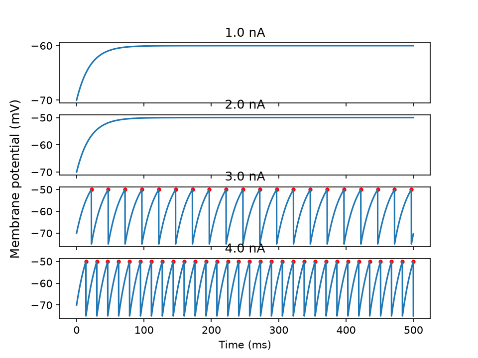

# Roadmap

Each version has a goal, background material, scope items and acceptance criteria. Versions are released as git tags (`v0.1`, `v0.2`, ...). The firmware track (v0.6) can run in parallel with v0.3-v0.5.

Principle: the parts that carry the project's claim are implemented from scratch, solved infrastructure is used as-is, and custom code is validated against the established tool (see [docs/own-vs-borrowed.md](docs/own-vs-borrowed.md)).

Note: links were checked when this roadmap was written. FlyWire data file names and column layouts may change between data releases; verify against [Codex](https://codex.flywire.ai/) and [data/README.md](data/README.md) before relying on them.

---

## v0.1 - Foundations and a single neuron (Done)

**Goal:** Implement a single leaky integrate-and-fire neuron.

**Background**
- Leaky integrate-and-fire neuron: membrane equation, threshold, reset, refractory period. Free textbook: [Neuronal Dynamics (Gerstner et al.)](https://neuronaldynamics.epfl.ch/), chapter 1.
- Euler integration and why the time step matters.
- Brian2 tutorial part 1: [Neurons](https://brian2.readthedocs.io/en/stable/resources/tutorials/1-intro-to-brian-neurons.html).

**Scope**
- [X] Dev environment and repo working (`pytest` runs).
- [X] `src/flybot/lif.py`: a single LIF neuron simulator in NumPy. Spec: [tasks/v0.1-01-single-lif-neuron.md](tasks/v0.1-01-single-lif-neuron.md).
- [X] A script in `experiments/` that plots membrane potential and spikes for a few input currents.
- [X] First dev log entry in `docs/devlog/`.

**Acceptance criteria**
- All tests in `tests/test_lif_single.py` pass.
- The rheobase (minimum constant current that produces a spike) is derived analytically and agrees with the simulation.

---

## v0.2 - Own network simulator, validated against Brian2 (In progress)

**Goal:** Simulate many connected neurons, and show that the simulator agrees with a trusted reference.

**Background**
- Synapses: current- or conductance-based, delta vs. exponential synaptic dynamics.
- Sparse matrices (`scipy.sparse`): why a connectome is stored as one.
- Brian2 tutorial part 2: [Synapses](https://brian2.readthedocs.io/en/stable/resources/tutorials/2-intro-to-brian-synapses.html), part 3: Simulations.
- Read the model section of Shiu et al. 2024 (the neuron and synapse equations used for the whole-brain model).

**Scope**
- [ ] v0.2-01: `LIFNetwork` with vectorised update ([task](tasks/v0.2-01-network-neurons.md))
- [ ] v0.2-02: Synapses, mutable weights, step hook ([task](tasks/v0.2-02-synapses.md))
- [ ] v0.2-03: Poisson input and random-network raster ([task](tasks/v0.2-03-poisson-and-raster.md))
- [ ] v0.2-04: Validation against Brian2 ([task](tasks/v0.2-04-brian2-validation.md))

**Acceptance criteria**
- Spike counts per neuron agree with Brian2 within a stated tolerance, and the tolerance and reasons for residual differences are written down.

---

## v0.3 - The real connectome

**Goal:** Load the real fly wiring data and run it.

**Background**
- What FlyWire is and how to read the data: [Dorkenwald et al. 2024](https://doi.org/10.1038/s41586-024-07558-y) (read the abstract, Figure 1 and the section on neuron classes), [Codex FAQ](https://codex.flywire.ai/faq).
- Neuron annotations: `super_class` (sensory, descending, motor, ...), neurotransmitter type, cell types. Companion paper: [Schlegel et al. 2024](https://doi.org/10.1038/s41586-024-07686-5).
- Reference implementations (read for the method, not copied): [philshiu/Drosophila_brain_model](https://github.com/philshiu/Drosophila_brain_model), [eonsystemspbc/fly-brain](https://github.com/eonsystemspbc/fly-brain).

**Scope**
- [ ] Data loader: download/read connectivity and neuron tables, build a `scipy.sparse` weight matrix with signs from neurotransmitter identity.
- [ ] Run the custom simulator on the full connectome (or a justified subset if the full network is too slow).
- [ ] Benchmark: simulated seconds per wall-clock second on the RTX 4060 and on CPU. Consider a PyTorch/GPU backend if needed.
- [ ] Reproduce one qualitative result from Shiu et al. (for example, that activating a known sensory population drives a known downstream population).

**Acceptance criteria**
- A raster plot from the real connectome exists, the benchmark table is in the repo, and one published result is reproduced or the difference is explained.

**Fallback:** if the full network is too slow for the control loop, use a documented subcircuit (the DesktopFly project runs a 668-neuron circuit extracted from FlyWire, so this is an accepted approach).

---

## v0.4 - Choose inputs and outputs (decision gate)

**Goal:** Determine whether the circuit yields usable control signals before further hardware spending.

**Background**
- Descending neurons as the brain's motor output: [Stürner et al., *Comparative connectomics of the descending and ascending neurons of the Drosophila nervous system*](https://github.com/flyconnectome/2023neckconnective) (data and annotations).
- Rate coding: turning spike trains into a smooth firing rate.

**Scope**
- [ ] Select candidate input neuron groups (for example, visual or light-responsive sensory neurons) and output groups (descending neurons).
- [ ] Sweep input intensity, record output-group firing rates, plot response curves.
- [ ] Decide on the encoder (sensor value to stimulation rate) and the decoder (rates to command).

**Acceptance criteria / decision gate**
- At least one input-output pairing shows a clear, monotonic, repeatable response. If not, change neuron sets, then fall back to a subcircuit. Hardware work is gated on this result.

---

## v0.5 - Closed loop in simulation, with learning

**Goal:** Validate the closed loop and the learning layer in a virtual environment before using hardware.

**Background**
- Reservoir computing: [Lukosevicius, A Practical Guide to Applying Echo State Networks](https://www.ai.rug.nl/minds/uploads/PracticalESN.pdf), [te Vrugt, An introduction to reservoir computing](https://arxiv.org/abs/2412.13212).
- Ridge regression (normal equation) and the washout period.
- Simple reward-driven weight updates (a delta rule with a reward signal).

**Scope**
- [ ] A tiny 2D world: a point agent, a light source, a noisy light sensor model.
- [ ] Fixed connectome as the reservoir, trainable linear readout from selected neuron rates to turn/forward commands.
- [ ] Offline training with ridge regression (target: an ideal controller), implemented from scratch and checked against scikit-learn.
- [ ] Online training with a reward signal (approach light = reward).
- [ ] **Control experiments:** same task with a size-matched random network instead of the connectome, and with silenced neuron subsets (lesions).

**Acceptance criteria**
- A learning curve shows the agent reaching the light more efficiently over time, and the control comparison is reported honestly whichever way it comes out.

---

## v0.6 - Robot firmware and host bridge

**Goal:** A robot that obeys a PC over a reliable link, with measured latency. This track can start any time after v0.2.

**Background**
- STM32F407 reference manual (RM0090): ADC with DMA, timers and PWM, USB OTG FS (CDC virtual COM port).
- Fixed-period control loops (timer interrupt vs. main loop), watchdogs, timeouts.
- Framing and CRC (for example CRC-16) for a packet protocol.

**Scope**
- [ ] Chassis: two driven wheels, motor driver, two or more light sensors (and optionally a distance sensor).
- [ ] Firmware in C on the STM32F407G-DISC1: sensor sampling (ADC + DMA), PWM motor output, fixed-period control loop, safe stop on link loss.
- [ ] Packet protocol (header, length, payload, CRC) documented in `docs/protocol.md`.
- [ ] `host/` Python bridge using pySerial, with logging.
- [ ] Latency measurement: round-trip time distribution.

**Acceptance criteria**
- A command sent from the PC moves the wheels, sensor values stream back, link loss stops the motors, and a latency histogram is in the repo.

---

## v0.7 - Hardware in the loop

**Goal:** The real robot closes the loop through the real-connectome simulation.

**Scope**
- [ ] Join the v0.5 pipeline (encoder, connectome simulation, decoder) to the v0.6 bridge.
- [ ] Timing budget: control-loop period vs. simulation window length, documented and measured.
- [ ] Safety and failure behaviour: stale data, simulation too slow, serial dropouts.

**Acceptance criteria**
- The robot responds to a light with connectome-driven motion without manual intervention, and the loop timing is logged.

---

## v0.8 - Learning on the robot and experiments

**Goal:** Real-world learning curve and the scientific comparisons.

**Scope**
- [ ] Run the reward-based readout learning on the physical robot.
- [ ] Repeat the control experiments from v0.5 on hardware where practical (random network, lesions).
- [ ] Structured logging so every experiment is reproducible from the repo.

**Acceptance criteria**
- Real-robot learning curves and control comparisons are saved with scripts that regenerate the figures.

---

## v1.0 - Release

**Goal:** Make the project understandable to someone who has never seen it.

- [ ] Video of the robot behaving, plus the learning curve.
- [ ] Short report: motivation, method, results, **limitations and negative results**.
- [ ] README updated with results and a "how to reproduce" section.
- [ ] Parts list and wiring diagram.
- [ ] Tag `v1.0`.

---

## After v1.0 (ideas, not commitments)

- **v1.1** Wireless robot using the Arduino UNO Q as an on-board bridge (Wi-Fi to the PC, real-time sensing and motors on its MCU).
- **v1.2** Better sensing (more sensor types, mapped to the matching sensory neuron classes).
- **v2.0** Synaptic plasticity inside the connectome (research-grade and uncertain; the connectome does not specify plasticity rules, so the rules would be an own hypothesis to test).
- **Later** A legged or flying platform. Flight stabilisation is a separate hard problem and would likely keep a conventional flight controller underneath.

---

## Working principles

- Hardware purchases for a stage wait until the preceding decision gate passes.
- Every version ends with something runnable and a dev log entry.
- Measured numbers (speed, latency, spike agreement) take precedence over claims.
