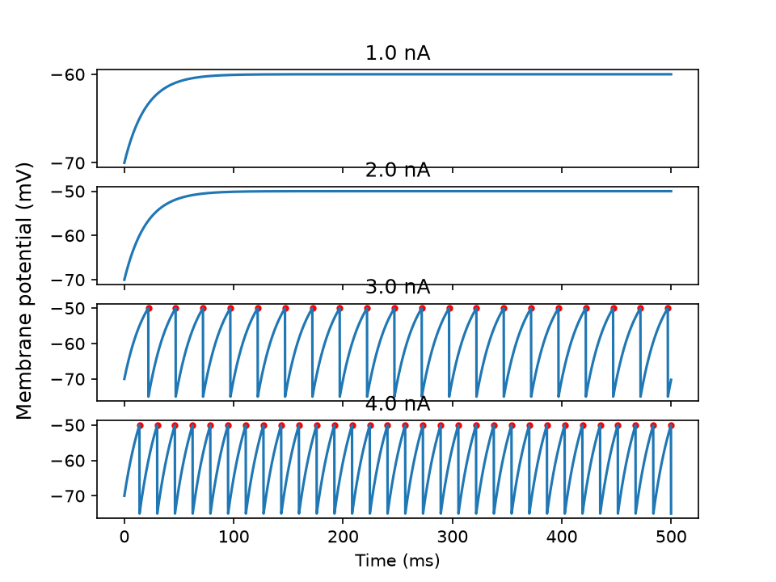
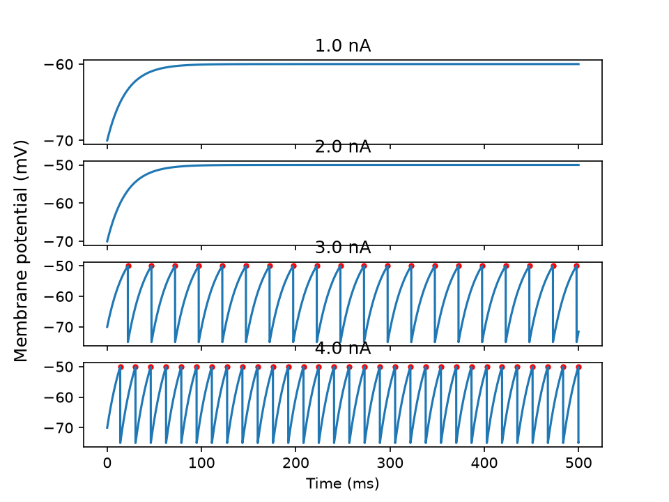
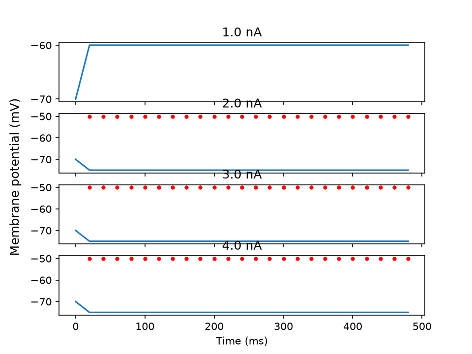

# 2026-11-09 - Single LIF neuron

## What I did

- Implemented `simulate_lif` in `src/flybot/lif.py`: forward Euler integration, threshold and reset, and a refractory period implemented with a step counter.
- All 8 tests in `tests/test_lif_single.py` pass.
- Wrote `experiments/v0_1_single_neuron.py`, which simulates 1, 2, 3 and 4 nA input for 500 ms and plots `v(t)` (`docs/figures/v0_1_single_neuron.png`).

Conventions (also in the docstring):

- `v[0] = v_rest`.
- A spike is recorded at time `(step + 1) * dt`, the step at which the new potential crossed the threshold.
- On a spike step the stored `v` is `v_reset`, not the pre-reset peak. Spike peaks therefore do not appear in plots of `v`.

## Analysis questions

### 1. Why does 1 nA never spike while 3 nA does?

With a constant current the potential does not rise forever. It approaches a steady state

```
v_inf = v_rest + r_m * I
```

A spike is only possible if `v_inf` is above the threshold, which gives the threshold current (rheobase)

```
I_th = (v_th - v_rest) / r_m = (-50 - (-70)) / 10 = 2 nA
```

- 1 nA: `v_inf = -60 mV`, below the threshold. No spike.
- 2 nA: `v_inf = -50 mV`, exactly the threshold. The potential approaches it asymptotically and never crosses it. A 20 s run (200,000 steps) still produced no spike (maximum `v` = -50.0000 mV).
- 2.1 nA: spikes (307 in 20 s).
- 3 nA: spikes regularly.

My first explanation was that the potential did not reach the threshold "within 5000 steps". That was wrong: running longer does not help, the limit is the steady state, not the simulation time.

Simulation with `dt = 0.1 ms`:



### 2. What changes when `dt` is halved?

Smaller `dt` gives a more accurate result. First spike time at 3 nA, simulated for the same 500 ms in each case:

| `dt` (ms) | first spike (ms) | spikes in 500 ms |
|---|---|---|
| 0.1 | 22.00 | 20 |
| 0.05 | 21.95 | 20 |
| 0.01 | 21.97 | 20 |

The analytic first spike time is `tau_m * ln 3 = 21.972 ms`, so the numerical result approaches the continuous-time solution as `dt` shrinks. The spike intervals do not widen; the spike count stays the same. The cost of a smaller `dt` is more steps and a slower simulation.

My first comparison was flawed: I kept 5000 steps while halving `dt`, which halved the simulated duration to 250 ms. To compare fairly the number of steps must be scaled so the duration stays 500 ms.

Simulation with `dt = 0.05 ms`:



### 3. What happens with a very large `dt` (`dt = tau_m = 20 ms`)?

With `dt = tau_m` the factor `dt / tau_m` in the Euler update is 1, so the potential jumps to its steady state in one step. At 3 nA that is `-70 + 30 = -40 mV`, above the threshold. The neuron spikes on every step (5000 spikes in 5000 steps, 20 ms apart), is reset, and jumps again. The model no longer charges gradually, and it can only spike once per step.

In the plot the spikes are not visible. `v` only contains `-70` and `-75`, because the stored value on a spike step is `v_reset` (see the conventions above). The spikes are only visible in the `spike_times` output.

Simulation with `dt = 20 ms`:



## Mistakes and fixes

- Converted step to time with a division (`dt / step`) instead of a multiplication. Symptom: spike times shrinking over time. Found by looking at the spike times in the failing test output.
- Overwrote the threshold parameter (`v_th = ...`) instead of resetting `v`.
- The refractory test passed even without refractory logic, because the natural interval at 10 nA (5.44 ms) is already longer than `t_ref = 5 ms`. Changed the test to `t_ref = 10 ms` so it fails without an implementation.

## Next

v0.2: a network of LIF neurons with a sparse weight matrix, validated against Brian2. The weight matrix will be kept as mutable state of the network so that learning rules can be added later.